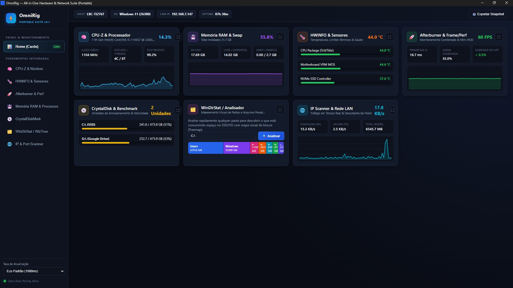
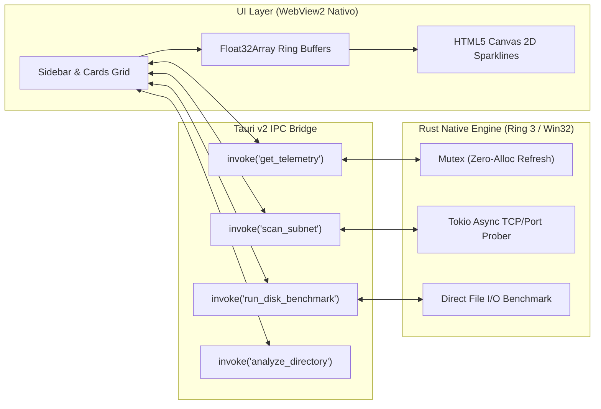

# ⚡ OmniRig Monitor — Portable All-in-One Hardware, Disk & Network Suite

[](LICENSE)
[](https://www.rust-lang.org/)
[](https://v2.tauri.app/)
[](#)
[](#)

**OmniRig Monitor** é uma suíte utilitária **100% portable (`.exe` único / `.zip`)** e ultra-leve desenvolvida em **Rust + Tauri v2**. Seu objetivo é consolidar as principais ferramentas de diagnóstico, benchmark e monitoramento de PC em uma única interface moderna, rápida e com consumo próximo de **0% de CPU**.



---

## 🎯 Por que o OmniRig?

Em vez de baixar, instalar e abrir 6 ou 7 aplicativos separados toda vez que você precisa diagnosticar ou monitorar uma máquina, o **OmniRig** reúne tudo em um único executável portable de **~3 MB** que roda direto do pendrive ou de qualquer pasta:

| Ferramenta Tradicional | Módulo Equivalente no OmniRig | Destaques da Implementação |
| :--- | :--- | :--- |
| **CPU-Z** | 🧠 **CPU-Z & Núcleos** | Modelo, núcleos físicos/lógicos, frequência média e barras individuais de carga por thread. |
| **HWiNFO64** | 🌡️ **HWiNFO & Sensores** | Tabela de telemetria térmica com registro contínuo de valores **Atual**, **Mínimo**, **Máximo** e **Crítico**. |
| **MSI Afterburner** | 🚀 **Afterburner & Perf** | Monitoramento de FPS/Frametime, simulador visual de **OSD Overlay** (estilo RivaTuner) e perfis de baixa latência. |
| **Task Manager / RAMMap** | 💾 **Memória RAM & Processos** | Gráfico de alocação física e Swap/Pagefile + Top 15 processos consumidores carregados sob demanda. |
| **CrystalDiskMark** | 💿 **CrystalDisk & Benchmark** | Saúde das partições montadas + motor nativo de benchmark **SEQ1M** (Leitura/Escrita) e **RND4K** (`MB/s` e `IOPS`). |
| **WinDirStat / WizTree** | 🗂️ **WinDirStat / Analisador** | Mapeamento rápido de diretórios em Rust com gráfico **Treemap** proporcional de blocos e ranking de pastas. |
| **Angry IP Scanner** | 🌐 **IP & Port Scanner (LAN)** | Medidor de tráfego RX/TX em tempo real + scanner assíncrono (`tokio`) de 254 IPs (`/24`) em paralelo. |

---

## 🏗️ Arquitetura & Engenharia de Baixo Consumo

O grande diferencial do OmniRig é sua arquitetura projetada para **não interferir na performance do computador** enquanto monitora:



### Os 4 Pilares de Performance:
1. **Zero-Allocation Polling:** Tanto o backend em Rust (`Mutex<System>`) quanto o frontend (`Float32Array` com `copyWithin`) alocam memória uma única vez na inicialização. Não há criação de objetos em loop nem picos de *Garbage Collection*.
2. **Sem WMI Pesado em Loop:** Consultas diretas via APIs nativas do sistema operacional através da crate `sysinfo`.
3. **Coleta Sob Demanda (Lazy Process Enumeration):** A varredura completa da árvore de processos do sistema só é executada quando o card de **Memória RAM & Processos** está maximizado.
4. **Hibernação Automática em Background:** Ao minimizar a janela ou pausar o seletor na barra lateral, o loop de renderização Canvas é suspenso, mantendo **0.0% de uso de CPU/GPU**.

---

## 🖥️ Interface do Usuário (Sidebar + Cards Maximizáveis)

- **Barra Lateral Esquerda:** Permite alternar rapidamente entre a visão geral (**Home / Todos os Cards**) e qualquer ferramenta específica, além de ajustar a taxa de atualização em tempo real (`500ms`, `1000ms`, `2.5s` ou `Pausado`).
- **Grade de Cards Inteligente (Home):** Exibe o resumo ao vivo e gráficos *sparkline* dos últimos 60 ciclos de todas as ferramentas simultaneamente.
- **Modo Maximizado (`⛶` / `🗗`):** Clicar no botão de expandir em qualquer card faz com que ele ocupe toda a área útil da janela direita, revelando tabelas detalhadas, configurações e botões de execução de ferramentas.

---

## 🚀 Como Baixar e Usar (Versão Portable)

1. Acesse a aba **[Releases](../../releases)** deste repositório.
2. Baixe o arquivo `OmniRig-Portable-v0.1.0.zip` (apenas **~1.3 MB**).
3. Extraia e execute `OmniRig-Portable.exe` em qualquer PC com Windows 10 ou Windows 11 (não requer instalação nem privilégios de administrador para uso padrão).

---

## 🛠️ Como Compilar a Partir do Código-Fonte

### Pré-requisitos
- **Rust Toolchain** (`rustup`, `cargo`, `rustc` 1.80+)
- **Visual Studio 2022 C++ Build Tools** (Workload *Desktop development with C++*)
- **Microsoft Edge WebView2 Runtime** (Já incluso nativamente no Windows 10/11)

### Passos para Build

```powershell
# 1. Clone o repositório
git clone https://github.com/cesarzetto/omnirig-monitor.git
cd omnirig-monitor

# 2. Compile o binário otimizado em modo Release (LTO + Strip ativados)
cargo build --release --manifest-path src-tauri/Cargo.toml

# 3. O executável portable único estará disponível em:
# src-tauri/target/release/omnirig-monitor.exe
```

---

## 📂 Estrutura do Projeto

```text
omnirig-monitor/
├── docs/
│   └── github-actions-ci.yml  # Pipeline CI/CD para build Windows Portable
├── prints/
│   └── omnirig_1.jpg          # Screenshot oficial da interface OmniRig
├── src-tauri/
│   ├── icons/                 # Ícones nativos do executável Windows (.ico / .png)
│   ├── src/
│   │   └── main.rs            # Motor em Rust (Telemetria, DiskMark, DirStat e IP Scanner)
│   ├── build.rs               # Script de compilação de recursos Tauri
│   ├── Cargo.toml             # Dependências Rust e flags de otimização de binário
│   └── tauri.conf.json        # Configuração de janela e empacotamento Tauri v2
├── ui/
│   ├── index.html             # Estrutura da Sidebar esquerda e Grid de Cards expansíveis
│   ├── styles.css             # Tema Dark Hardware-Grade responsivo
│   └── app.js                 # Engine de gráficos Canvas 2D, Ring Buffers e ponte IPC
├── CHANGELOG.md               # Histórico de versões (SemVer)
├── CONTRIBUTING.md            # Guia de contribuição e padrões de código
├── LICENSE                    # Licença Open Source MIT
└── README.md                  # Documentação principal
```

---

## 📄 Licença

Distribuído sob a licença **MIT**. Veja o arquivo [LICENSE](LICENSE) para mais informações.

Desenvolvido por **César Zeneratto** ([@cesarzetto](https://github.com/cesarzetto)).
